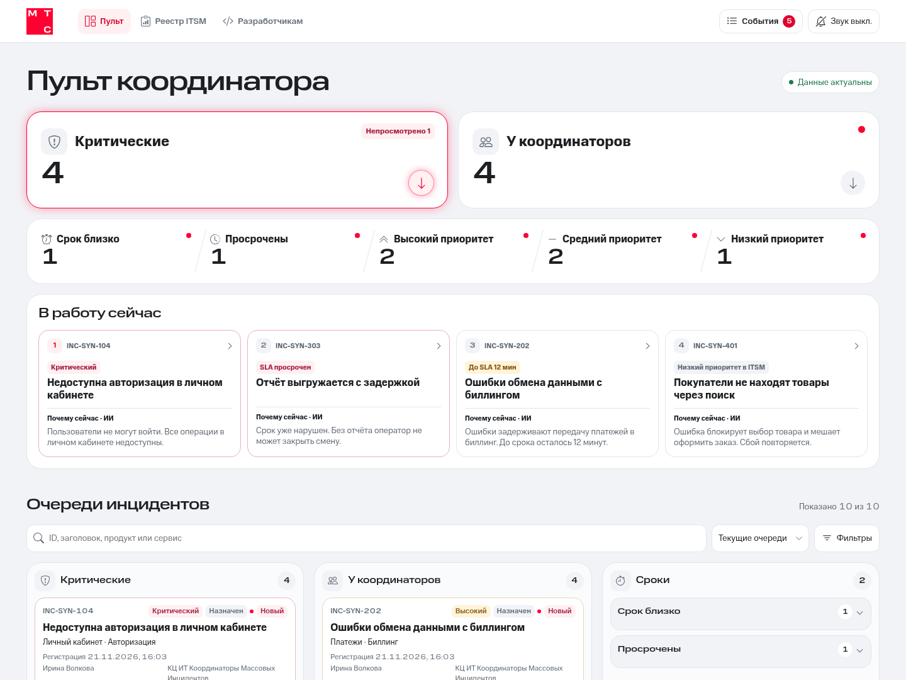
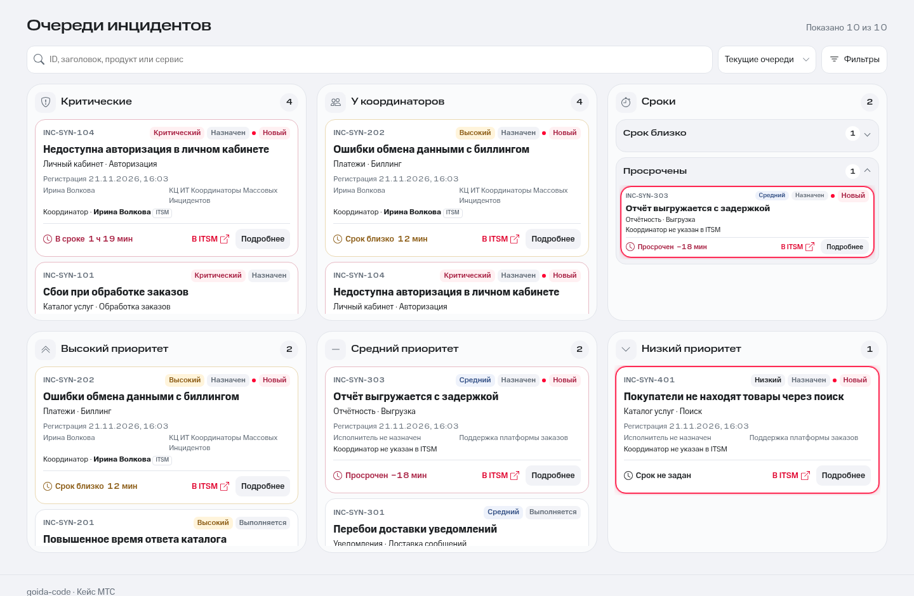

# Визуальная спецификация

Используй действующий пульт на `a16db4ae5a087000ddb81e81df30ba4634eca71a`, фон `--canvas`, белые поверхности `--surface`, контур `--line`, фирменный красный `--brand`, радиусы и фокус из темы. Заголовки и счётчики используют MTS Wide. Элементы управления и названия заявок используют MTS Compact. Короткий текст обоснования использует MTS Text. Иконки бери из библиотеки проекта. [Тема](../../apps/web/src/styles/theme.css)

## Лента «В работу сейчас»

Лента стоит между сводкой и заголовком «Очереди инцидентов». У неё одна внешняя поверхность. Слева направо идут карточки в порядке срочности. На референсе видно четыре. На узком экране лента прокручивается по горизонтали в своей области, а страница сохраняет вертикальную прокрутку.

Верхняя строка карточки содержит номер в порядке действий, ID заявки и указатель перехода. Дальше идут метка из данных, название и короткий блок «Почему сейчас · ИИ». Приоритет ITSM может оставаться низким даже у заявки, попавшей в ленту из-за наблюдаемого влияния. В референсе номера и тексты иллюстрируют сценарий, а выдача рассчитывается на принятой выгрузке.

Вся карточка — одно действие для мыши и клавиатуры. Нажатие прокручивает к заявке в нужном блоке и сразу открывает её «Подробнее». Обоснование из выбранной карточки видно в верхней части панели деталей. [Референс деталей](references/03-ai-recommendation-details.png)

## Переходы из сводки и сроки

На пульте две секции блока «Сроки» по умолчанию свёрнуты. В свёрнутом состоянии видны название, счётчик и стрелка раскрытия. При нажатии «Срок близко» или «Просрочены» в сводке открой только соответствующую секцию перед прокруткой. Заголовок секции позволяет открыть или закрыть её вручную.

Карточка, к которой привёл переход из любой из семи категорий сводки, получает красную рамку и внешнее свечение. Видно, какой экземпляр карточки выбран, если ID встречается и в SLA, и в приоритетной очереди. Выбранные карточки сохраняют свечение после следующих переходов, пока оператор не откроет их «Подробнее». Подсветка остаётся различимой при `prefers-reduced-motion`.

## Критическая сводка и события

- При ненулевом числе активных критических верхний блок имеет красную рамку и внешнее свечение. Счётчик стоит под заголовком.
- При новом непросмотренном критическом событии покажи «Непросмотрено N» в правом верхнем углу и красное свечение стрелки справа внизу. После просмотра последнего нового события эти два сигнала уходят. Общая рамка соответствует наличию активных критических.
- На страницах пульта отсутствуют всплывающие карточки событий в правой нижней части экрана. В шапке работает кнопка «События» с действующим счётчиком. В журнале доступны вид событий, время, фильтры, закрепление и переход к заявке.
