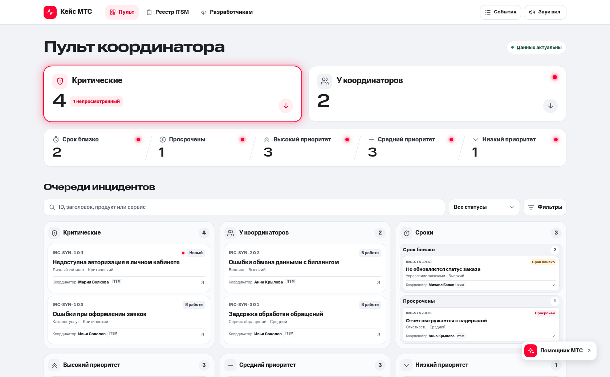
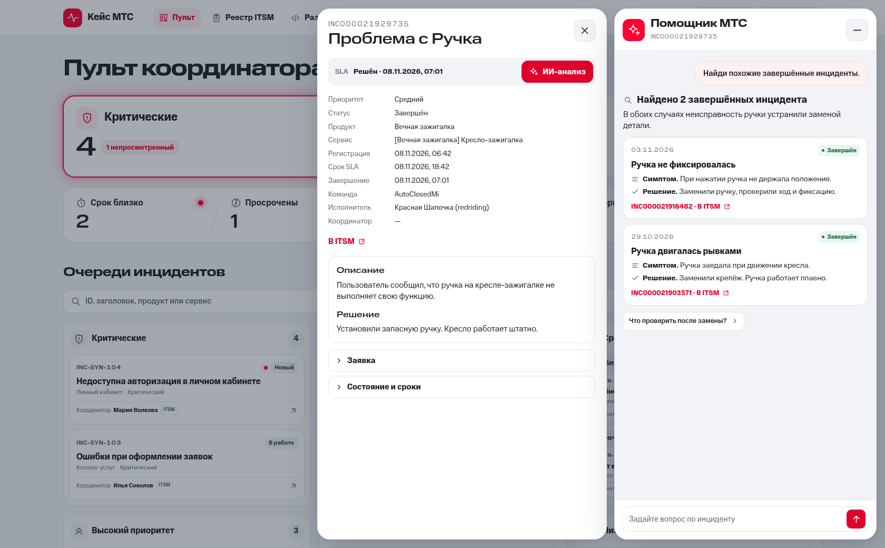
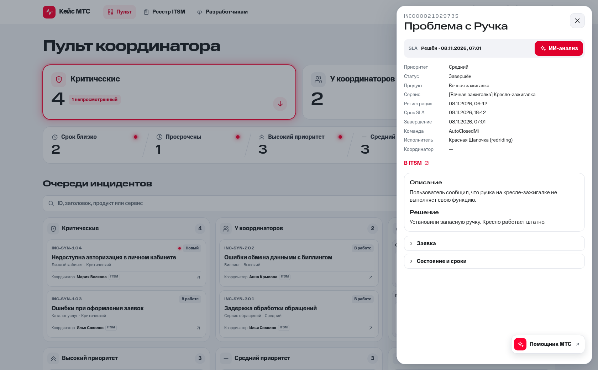

# Помощник МТС · визуальная спецификация

Используй вёрстку пульта и панели инцидента из принятого D40. Базовые цвета, отступы, радиусы, иконки и локальные шрифты бери из темы проекта. В исходной ветке это apps/web/src/styles/theme.css и apps/web/src/styles/fonts/. Сохранённая типографика макетов — MTS Wide для заголовков, MTS Compact для элементов управления, MTS Text для текста ответа.

## 1. Главный экран «Пульт»

Кнопка «Помощник МТС» с красной иконкой закреплена в правом нижнем углу окна. Она видна при входе на «Пульт», при прокрутке и с открытым «Подробнее», пока чат закрыт или свёрнут. При открытии чата кнопка скрывается. Положение кнопки сохраняется при возвращении в свёрнутое состояние.

## 2. «Подробнее» и запуск анализа

«ИИ-анализ» — заметная кнопка вверху карточки, справа от SLA. При отсутствии SLA действие остаётся в верхней части деталей. Клик открывает чат с номером выбранного инцидента и запускает поиск похожих завершённых заявок. Верхняя кнопка передаёт контекст инцидента. Нижняя кнопка открывает тот же чат из свёрнутого состояния. При первом запуске с «Пульта» без выбранного инцидента помощник предлагает ввести номер или кратко описать проблему.

## 3. Раскрытый чат и результаты

Чат «Помощник МТС» выезжает справа налево. На референсе ширина около 30% экрана. Панель занимает доступную высоту справа с обычными отступами от края окна. Нижняя плавающая кнопка скрыта. Сведения об инциденте остаются видны рядом слева. В шапке чата — имя помощника, номер инцидента при наличии контекста и «Свернуть». Внизу внутри чата — поле вопроса и отправка. На узком экране располагай чат доступно в одном слое, с видимым управлением и без горизонтального скролла.

Ответ показывает число найденных совпадений и краткий общий вывод, который опирается на архив. В каждой карточке результата видны дата, признак завершения, название, симптом, решение и ссылка «В ITSM» с номером. Если запись подтверждает итог, его можно включить в выжимку. Сдержанные иконки помогают различать поиск, симптом, решение и ссылку. Текст нужен и в тех случаях, когда значки не воспринимаются.

В примере ответ выглядит так:

> Найдено 2 завершённых инцидента. В обоих случаях неисправность ручки устранили заменой детали.
>
> **Ручка не фиксировалась.** Симптом — при нажатии ручка не держала положение. Решение — заменили ручку, проверили ход и фиксацию. В ITSM — INC000021916482.

В приложении номера, ссылки и содержание должны происходить из найденных записей. Тон «Помощника МТС» деловой и краткий. Для отсутствия совпадений предусмотрен понятный ответ без карточек. Повторный вопрос остаётся в рамках выбранного контекста или уточнённого запроса.

## 4. Свёрнутый чат

Сворачивание из шапки возвращает фокус к контексту оператора. Кнопка «Помощник МТС» вновь появляется на прежнем месте. Повторное раскрытие возвращает текущую переписку. Анимация использует правый край экрана, при сокращённом движении состояние меняется без выезда.

[Анимация согласованного перехода](references/04-ai-assistant-motion.gif)

## Схема без изображения

~~~text
Пульт ── закреплённая «Помощник МТС» ──► Чат без контекста или текущий диалог
Детали ── верхняя «ИИ-анализ» ─────────► Чат по ID и автоматический поиск
Чат ── «Свернуть» ────────────────────► Та же закреплённая кнопка
~~~

Точное поведение входов и интерфейса проверяй по [D80](D80-assistant-ui.md) и [D90](D90-acceptance.md).
