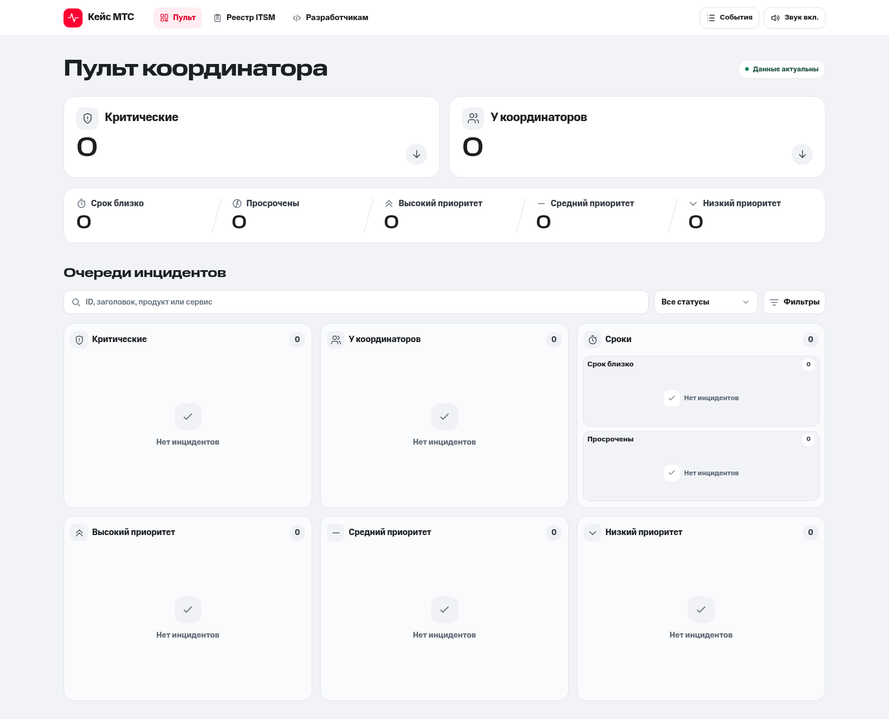
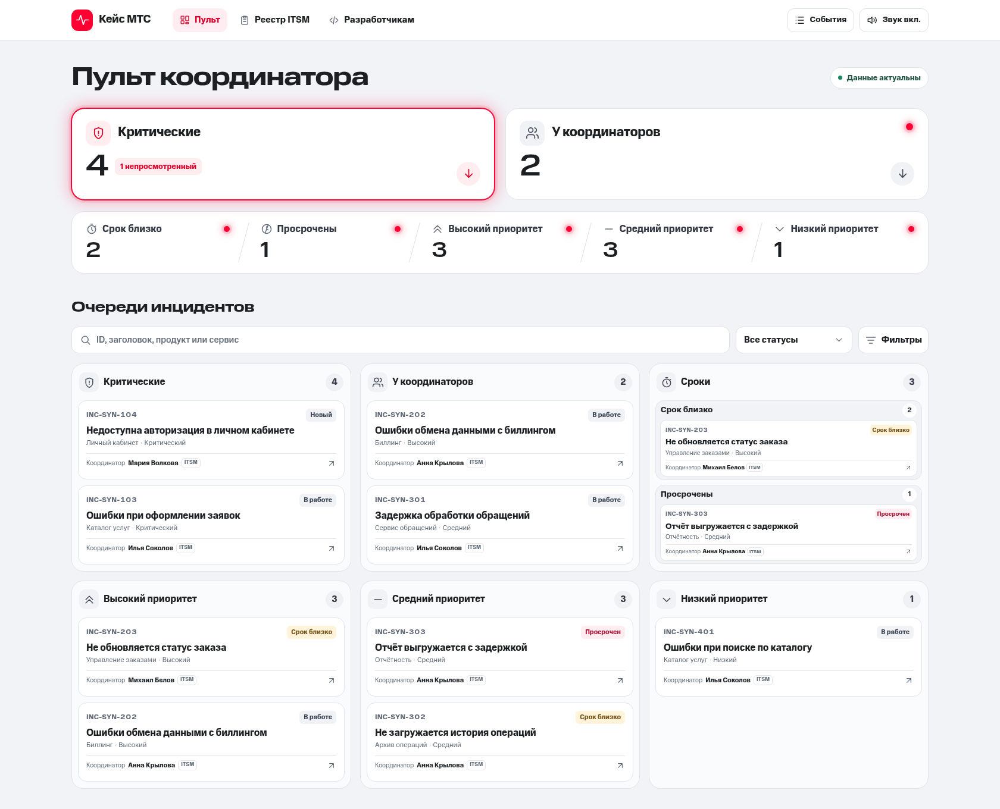

# Визуальная спецификация пульта

Проверенная база — fix/dashboard-review, 5aa37dc9d81c391a865b01ed5453612e8b664b77. Ветка даёт шапку, сетку, типографику, значки, оформление карточек и состояния элементов управления. PNG из этого пакета задают расположение новых блоков и вид оповещений. Запусти исходный пульт командой npm run dev:web и открой /admin/incidents для сверки деталей базового интерфейса.

## Референс 1 · Без инцидентов

Обе крупные карточки и полоса ниже видны сразу. Счётчики равны нулю. Цвет фона и рамок обычный. Под поиском и фильтрами видны шесть блоков очередей. Пустое состояние показано и в обеих секциях блока «Сроки».

## Референс 2 · С непросмотренными инцидентами

Красная рамка и внешнее свечение выделяют **весь первый блок**. Счётчик 4 включает три просмотренных инцидента и один новый. На «У координаторов» и сегментах нижней панели новые события обозначены маленькими красными точками. Счётчики и содержимое карточек на PNG условные. В рабочем приложении они вычисляются из данных.

## Схема широкого экрана

~~~text
Кейс МТС   Пульт   Реестр ITSM   Разработчикам              События  Звук

Пульт координатора                                        Данные актуальны

┌──────────────────────────────┐ ┌───────────────────────────────────┐
│ Критические                  │ │ У координаторов                   │
│ Общий счётчик              ↓ │ │ Общий счётчик                   ↓ │
└──────────────────────────────┘ └───────────────────────────────────┘

┌────────────────────────────────────────────────────────────────────┐
│ Срок близко / Просрочены / Высокий приоритет / Средний / Низкий      │
│ Счётчик       Счётчик     Счётчик             Счётчик  Счётчик     │
└────────────────────────────────────────────────────────────────────┘

Очереди инцидентов
Поиск по ID, заголовку, продукту или сервису       Статусы   Фильтры
[ Критические       ][ У координаторов    ][ Сроки                  ]
[                   ][                    ][ Срок близко            ]
[                   ][                    ][ Просрочены             ]
[ Высокий приоритет ][ Средний приоритет  ][ Низкий приоритет       ]
~~~

На экране используй полные названия «Средний приоритет» и «Низкий приоритет» в полосе сводки. У неё одна внешняя рамка и четыре внутренние диагонали. Ниже находится отдельная сетка очередей с двумя рядами по три блока. «Сроки» занимает правую ячейку первого ряда. Внутри одной карточки «Сроки» сверху идёт секция «Срок близко», за ней «Просрочены». Обе секции видны одновременно. Каждый сегмент сводки ведёт в соответствующую очередь или секцию.

## Визуальные правила

| Элемент | Правило |
|---|---|
| Контейнер и фон | Переиспользуй ширину контейнера и боковые отступы шапки из ветки. Светлый фон через --canvas, белые поверхности через --surface. |
| Тема | Используй --line, --radius-section, --radius-card, --space-section, --brand и существующие стили фокуса. |
| Шрифты | MTS Compact — текст и элементы управления, MTS Wide — заголовки и счётчики, MTS Text — там, где ветка применяет --font-text. Используй локальные начертания из theme.css. |
| Верхняя сводка | Две колонки одинаковой ширины на десктопе. Заголовок и число слева. Действие перехода видно у правого края. |
| Нижняя сводка | Пять сегментов с общей поверхностью, четырьмя диагональными разделителями, заголовком и числом в каждом. Длинные надписи и точка имеют отдельное место. |
| Очереди на широком экране | Три равные колонки в двух рядах. Слева направо в первом ряду «Критические», «У координаторов», «Сроки». Во втором ряду «Высокий приоритет», «Средний приоритет», «Низкий приоритет». |
| Блок «Сроки» | Общий заголовок, затем две секции «Срок близко» и «Просрочены». У каждой секции свой счётчик, список и пустое состояние. |
| Непросмотренное критическое | Красный --brand по внешнему периметру и мягкое внешнее свечение. Спокойную фазу и яркую фазу делай без скачка геометрии блока. |
| Остальное непросмотренное | Точка справа в верхней части соответствующего блока или сегмента. Обеспечь читаемое состояние при выключенной анимации и для скринридера. |
| Карточка инцидента | Переиспользуй заголовок, ID, статус, SLA и действия просмотра из ветки. Персональное имя выводи рядом с пометкой ITSM. |
| Адаптивность | При 1280×720 сводка читается целиком. При 390×844 допускается перенос блоков с сохранением порядка очередей и общей поверхности полосы. Следи за отсутствием скролла всей страницы по горизонтали и за работой клавиатуры. |

Подключения шрифтов и токены доступны в [theme.css](../../apps/web/src/styles/theme.css). Шесть исходных файлов находятся в [styles/fonts/](../../apps/web/src/styles/fonts/).

## Как читать состояния на PNG

| Ситуация | Что видно | Что происходит |
|---|---|---|
| Есть три просмотренных критических | Счётчик 3, спокойная карточка | Журнал и очереди работают в обычном состоянии. |
| Поступил четвёртый критический | Счётчик 4, пульсирует периметр | Один звуковой сигнал при включённом звуке. |
| Клик по «Критические» | Переход к новой карточке, два красных импульса | После просмотра конкретного события счётчик остаётся 4. Если новых больше нет, рамка успокаивается. |
| Поступило координаторское событие | Мигающая точка на «У координаторов» | Допускается звук при включённой настройке. |
| Поступило событие срока | Мигающая точка на «Срок близко» или «Просрочены» | Тихое событие. Клик ведёт к карточке в одноимённой секции блока «Сроки». |
| Поступило событие обычного приоритета | Мигающая точка на подходящем сегменте | Тихое событие. Клик ведёт к карточке в очереди соответствующего приоритета во втором ряду. |

В PNG показана яркая фаза свечения до нажатия. Поведение переходов, точное подтверждение просмотра и звук проверяй по [D30](D30-unread-and-sound.md) и [D40](D40-acceptance.md).
